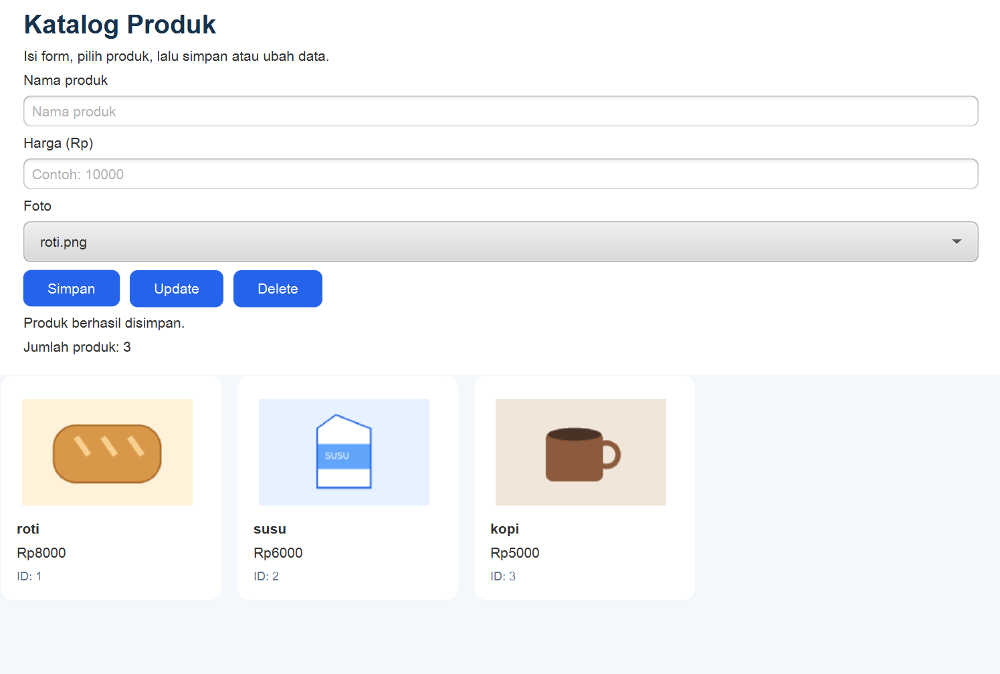
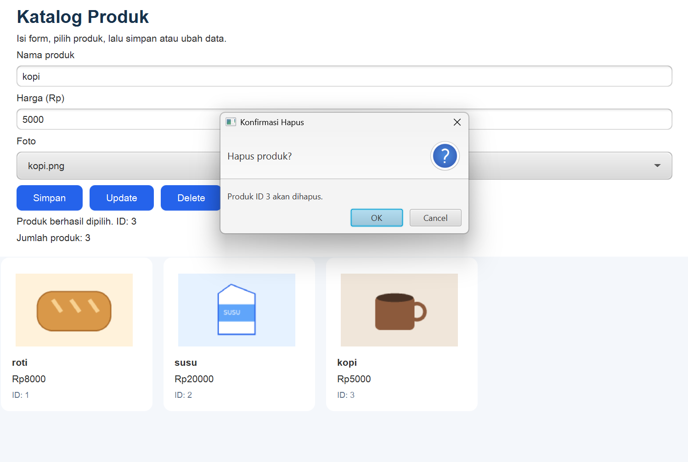
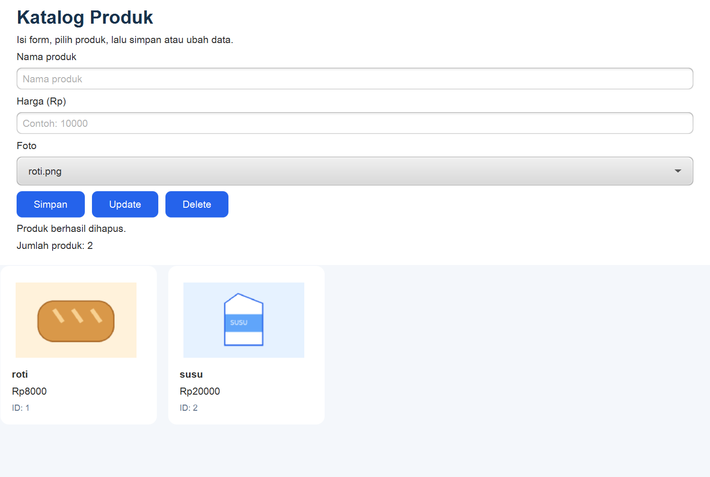

# Katalog Produk

Katalog Produk adalah aplikasi manajemen produk berbasis JavaFX dan Maven yang dikembangkan untuk membantu pengguna dalam mengelola data produk toko. Aplikasi ini menyediakan fitur untuk menambahkan, mengubah, dan menghapus data produk melalui form input. Setiap produk dilengkapi dengan informasi nama, harga, serta foto produk yang ditampilkan dalam bentuk katalog kartu.

Aplikasi ini menggunakan **SQLite sebagai database lokal** untuk menyimpan data produk secara permanen. Dengan demikian, data yang telah disimpan tidak akan hilang ketika aplikasi ditutup dan tetap tersedia saat aplikasi dijalankan kembali.

---

## 📋 Fitur Utama

1. **Tambah Produk**: Menambahkan produk baru melalui form input nama produk, harga, dan pilihan foto produk.
2. **Update Produk**: Mengubah informasi produk yang telah dipilih.
3. **Delete Produk**: Menghapus data produk dari database.
4. **Pilihan Foto Produk**: Memilih gambar produk yang tersedia melalui dropdown.
5. **Katalog Produk**: Menampilkan daftar produk dalam bentuk kartu yang dilengkapi foto, nama, harga, dan ID produk.
6. **Penyimpanan Database SQLite**: Menyimpan data produk secara lokal dan permanen sehingga data tetap tersedia meskipun aplikasi ditutup atau dijalankan kembali.
7. **Informasi Jumlah Produk**: Menampilkan total produk yang tersimpan dalam katalog.
8. **Status Operasi**: Memberikan informasi ketika proses penyimpanan produk berhasil dilakukan.

---

## 🚀 Cara Menjalankan Aplikasi

### 1. Clone Repository

Buka terminal atau Command Prompt, kemudian jalankan perintah berikut:

```bash
git clone https://github.com/lannmhrni/KatalogProduk.git
```

### 2. Masuk ke Direktori Project

Setelah proses clone selesai, arahkan terminal ke folder proyek:

```bash
cd KatalogProduk
```

### 3. Buka Project di Apache NetBeans

1. Buka aplikasi Apache NetBeans.
2. Pilih **File → Open Project**.
3. Cari dan pilih folder project yang telah di-clone.
4. Tunggu hingga proses pemuatan dependency Maven selesai.

### 4. Jalankan Aplikasi

Buka terminal pada direktori utama project, kemudian jalankan perintah:

```bash
mvn clean javafx:run
```

Tunggu hingga proses build selesai. Jika berhasil, aplikasi Katalog Produk akan terbuka dan siap digunakan.

**Catatan:** Pastikan Java Development Kit (JDK) dan Maven sudah terpasang serta konfigurasi JavaFX dan SQLite pada project sudah sesuai.

---

## 📸 Tampilan Aplikasi

### 1. Form Input dan Katalog Produk


### 2. Select Produk


### 3. Update Produk


### 4. Delete Produk


### 5. Results

